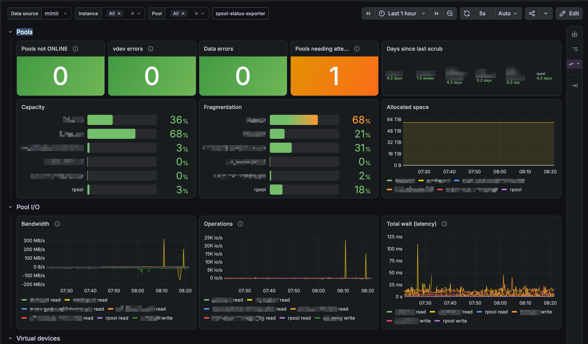

# zpool-status-exporter

A Prometheus exporter for ZFS. It reports pool and virtual device (vdev)
health, capacity, errors, scrub and resilver progress, I/O rates and
latencies, Adaptive Replacement Cache (ARC) and other kernel statistics,
dataset space, and Self-Monitoring, Analysis and Reporting Technology (SMART)
data for every disk.

FreeBSD is the primary platform. Linux support is best effort: its collectors
are tested against synthesized data only, not against a live host.

## Requirements

- OpenZFS 2.3 or later (the exporter reads `zpool status -j` and
  `zpool list -j`). FreeBSD 15.1 ships OpenZFS 2.4.
- smartmontools 7 or later for the SMART collector.
- Root privileges: `smartctl` needs raw disk access. Every other command works
  unprivileged, so disable the SMART collector (`--no-collector.smart`) to run
  as an ordinary user.

## Install

Release packages are attached to each GitHub release:

- FreeBSD: `pkg add zpool-status-exporter-<version>.pkg`, then
  `sysrc zpool_status_exporter_enable=YES` and
  `service zpool_status_exporter start`. Set extra flags with
  `sysrc zpool_status_exporter_args="..."`.
- Linux: install the RPM (Red Hat Package Manager) package, edit
  `/etc/sysconfig/zpool-status-exporter`, then
  `systemctl enable --now zpool-status-exporter`.

The exporter listens on port 10058 and serves metrics at `/metrics` and a
health check at `/healthz`. See `zpool-status-exporter --help` or the
`zpool-status-exporter(8)` manual page for every flag.

## Collectors

| Collector | Default interval | Source | Disable with |
|---|---|---|---|
| pool | 10s | `zpool status -j`, `zpool list -j`, `geom`/`glabel` or `lsblk` | `--no-collector.pool` |
| iostat | 10s | `zpool iostat -Hpvl -y 10 1` | `--no-collector.iostat` |
| arc | 10s | `sysctl kstat.zfs.misc.arcstats` or `/proc/spl/kstat/zfs/arcstats` | `--no-collector.arc` |
| kstat | 10s | `sysctl kstat.zfs` or `/proc/spl/kstat/zfs` | `--no-collector.kstat` |
| datasets | 1m | `zfs get -Hp` | `--no-collector.datasets` |
| smart | 10m | `smartctl --scan-open`, `smartctl -j -x -n standby` | `--no-collector.smart` |

Collectors run in the background on their own schedules, and a scrape only
returns their latest results, so scrapes never wait for a command. The iostat
collector samples one full interval per run, so its rates cover time without
gaps. The SMART collector passes `-n standby` so its regular queries do not
wake a sleeping disk, and it skips enclosure devices that `smartctl
--scan-open` lists. The device scan itself opens every device and may wake
disks, so it runs only at start and every six hours.

`zfs_exporter_collector_up`, `zfs_exporter_collector_duration_seconds`, and
`zfs_exporter_collector_last_success_timestamp_seconds` report the health of
each collector. A failed run removes that collector's metrics until it next
succeeds.

## Labels and joins

Every vdev series carries `pool`, `vdev` (the name ZFS shows, such as
`gpt/chassis02`), `vdev_type`, `class` (`normal`, `log`, `special`, `dedup`,
`l2cache`, or `spare`), `device` (the partition, such as `ada2p1`), and `disk`
(such as `ada2`). `zfs_disk_info` and `zfs_smart_device_info` carry the model,
serial number, and World Wide Name (WWN), so SMART data joins to vdevs:

```promql
# SMART temperature labelled with the disk name that vdev series use
zfs_smart_temperature_celsius * on (device) group_left (disk) zfs_smart_device_info

# Days since each pool's last completed scan
(time() - zfs_pool_scan_end_time_seconds) / 86400
```

`examples/alerts.yml` holds example Prometheus alerting rules, and
`examples/grafana-dashboard.json` is an example Grafana dashboard (pools,
vdevs, I/O, ARC, SMART, datasets, and collector health) to import with
Grafana's dashboard import, choosing a Prometheus data source. Neither file
is installed by the packages.



## Metrics

<!-- metrics-table:start -->
| Metric | Type | Labels | Description |
|---|---|---|---|
| `zfs_dataset_available_bytes` | gauge | `pool`, `dataset`, `type` | Space available to the dataset. |
| `zfs_dataset_compress_ratio` | gauge | `pool`, `dataset`, `type` | Compression ratio achieved for the dataset. |
| `zfs_dataset_logical_referenced_bytes` | gauge | `pool`, `dataset`, `type` | Data referenced before compression. |
| `zfs_dataset_logical_used_bytes` | gauge | `pool`, `dataset`, `type` | Space used before compression. |
| `zfs_dataset_quota_bytes` | gauge | `pool`, `dataset`, `type` | Quota of the dataset; 0 means none. |
| `zfs_dataset_read_bytes_total` | counter | `pool`, `dataset` | Bytes read from the dataset. |
| `zfs_dataset_reads_total` | counter | `pool`, `dataset` | Read operations on the dataset. |
| `zfs_dataset_referenced_bytes` | gauge | `pool`, `dataset`, `type` | Data referenced by the dataset. |
| `zfs_dataset_refquota_bytes` | gauge | `pool`, `dataset`, `type` | Reference quota of the dataset; 0 means none. |
| `zfs_dataset_refreservation_bytes` | gauge | `pool`, `dataset`, `type` | Reference reservation of the dataset. |
| `zfs_dataset_reservation_bytes` | gauge | `pool`, `dataset`, `type` | Reservation of the dataset. |
| `zfs_dataset_unlinked_total` | counter | `pool`, `dataset` | Files deleted on the dataset. |
| `zfs_dataset_unlinks_total` | counter | `pool`, `dataset` | Files queued for deletion on the dataset. |
| `zfs_dataset_used_by_children_bytes` | gauge | `pool`, `dataset`, `type` | Space used by descendants of the dataset. |
| `zfs_dataset_used_by_dataset_bytes` | gauge | `pool`, `dataset`, `type` | Space used by the dataset itself. |
| `zfs_dataset_used_by_refreservation_bytes` | gauge | `pool`, `dataset`, `type` | Space used by the dataset's refreservation. |
| `zfs_dataset_used_by_snapshots_bytes` | gauge | `pool`, `dataset`, `type` | Space used by snapshots of the dataset. |
| `zfs_dataset_used_bytes` | gauge | `pool`, `dataset`, `type` | Space used by the dataset and its descendants. |
| `zfs_dataset_volume_size_bytes` | gauge | `pool`, `dataset`, `type` | Logical size of a volume. |
| `zfs_dataset_writes_total` | counter | `pool`, `dataset` | Write operations on the dataset. |
| `zfs_dataset_written_bytes_total` | counter | `pool`, `dataset` | Bytes written to the dataset. |
| `zfs_dataset_written_since_snapshot_bytes` | gauge | `pool`, `dataset`, `type` | Data written since the latest snapshot. |
| `zfs_disk_info` | gauge | `disk`, `model`, `serial`, `wwn` | Disk identity from the operating system; always 1. |
| `zfs_exporter_collector_duration_seconds` | gauge | `collector` | Duration of the last run of a collector. |
| `zfs_exporter_collector_last_success_timestamp_seconds` | gauge | `collector` | Unix time of the last successful run of a collector. |
| `zfs_exporter_collector_up` | gauge | `collector` | Whether the last run of a collector succeeded (1) or failed (0). |
| `zfs_pool_allocated_bytes` | gauge | `pool` | Space allocated in the pool. |
| `zfs_pool_capacity_ratio` | gauge | `pool` | Fraction of the pool allocated (0 to 1). |
| `zfs_pool_checkpoint_bytes` | gauge | `pool` | Space held by the pool checkpoint. |
| `zfs_pool_data_errors` | gauge | `pool` | Number of known data errors in the pool. |
| `zfs_pool_dedup_ratio` | gauge | `pool` | Deduplication ratio of the pool. |
| `zfs_pool_expand_size_bytes` | gauge | `pool` | Unused space the pool could grow into. |
| `zfs_pool_fragmentation_ratio` | gauge | `pool` | Free-space fragmentation of the pool (0 to 1). |
| `zfs_pool_free_bytes` | gauge | `pool` | Free space in the pool. |
| `zfs_pool_latency_seconds` | gauge | `pool`, `op`, `queue` | Average I/O wait over the last interval, by operation and queue. |
| `zfs_pool_needs_attention` | gauge | `pool` | Whether zpool status prints a status message for the pool (1) or not (0). |
| `zfs_pool_read_bytes_per_second` | gauge | `pool` | Bytes read per second over the last interval. |
| `zfs_pool_read_operations_per_second` | gauge | `pool` | Read operations per second over the last interval. |
| `zfs_pool_scan_end_time_seconds` | gauge | `pool` | Unix time the last scan finished; absent unless the last scan finished. |
| `zfs_pool_scan_errors` | gauge | `pool` | Errors found by the current or last scan. |
| `zfs_pool_scan_examined_bytes` | gauge | `pool` | Bytes examined by the current or last scan. |
| `zfs_pool_scan_issued_bytes` | gauge | `pool` | Bytes issued by the current or last scan. |
| `zfs_pool_scan_paused` | gauge | `pool` | Whether the scan is paused (1) or not (0). |
| `zfs_pool_scan_repaired_bytes` | gauge | `pool` | Bytes repaired by the current or last scan. |
| `zfs_pool_scan_start_time_seconds` | gauge | `pool` | Unix time the current or last scan started. |
| `zfs_pool_scan_state` | gauge | `pool`, `function`, `state` | Current or last scan (scrub, resilver, or error scrub) of the pool; always 1. |
| `zfs_pool_scan_to_examine_bytes` | gauge | `pool` | Bytes the current or last scan has to examine. |
| `zfs_pool_size_bytes` | gauge | `pool` | Pool size. |
| `zfs_pool_state` | gauge | `pool`, `state` | Pool state; 1 for the current state, 0 for the others. |
| `zfs_pool_write_bytes_per_second` | gauge | `pool` | Bytes written per second over the last interval. |
| `zfs_pool_write_operations_per_second` | gauge | `pool` | Write operations per second over the last interval. |
| `zfs_smart_attribute_raw_value` | gauge | `device`, `id`, `attribute` | Raw value of an ATA SMART attribute. |
| `zfs_smart_attribute_threshold` | gauge | `device`, `id`, `attribute` | Failure threshold of an ATA SMART attribute. |
| `zfs_smart_attribute_value` | gauge | `device`, `id`, `attribute` | Normalized value of an ATA SMART attribute. |
| `zfs_smart_attribute_worst` | gauge | `device`, `id`, `attribute` | Worst normalized value of an ATA SMART attribute. |
| `zfs_smart_device_info` | gauge | `device`, `disk`, `model`, `serial`, `wwn`, `firmware`, `protocol` | Identity of a device read by smartctl; always 1. |
| `zfs_smart_device_standby` | gauge | `device` | Whether the device was in standby or sleep and was not woken (1) or not (0). |
| `zfs_smart_device_up` | gauge | `device` | Whether smartctl returned SMART data for the device (1) or not (0). |
| `zfs_smart_error_log_entries` | gauge | `device` | Entries in the device error log. |
| `zfs_smart_exit_status_bit` | gauge | `device`, `bit`, `meaning` | smartctl exit status bits 2 to 7; 1 when the bit is set. |
| `zfs_smart_healthy` | gauge | `device` | Whether the SMART overall health self-assessment passed (1) or failed (0). |
| `zfs_smart_power_cycles` | gauge | `device` | Device power cycle count. |
| `zfs_smart_power_on_seconds` | gauge | `device` | Device power-on time. |
| `zfs_smart_temperature_celsius` | gauge | `device` | Current device temperature. |
| `zfs_vdev_allocated_bytes` | gauge | `pool`, `vdev`, `vdev_type`, `class`, `device`, `disk` | Space allocated on the vdev. |
| `zfs_vdev_checksum_errors` | gauge | `pool`, `vdev`, `vdev_type`, `class`, `device`, `disk` | Checksum errors on the vdev since the last zpool clear. |
| `zfs_vdev_fragmentation_ratio` | gauge | `pool`, `vdev`, `vdev_type`, `class`, `device`, `disk` | Free-space fragmentation of a top-level vdev (0 to 1). |
| `zfs_vdev_latency_seconds` | gauge | `pool`, `vdev`, `vdev_type`, `class`, `device`, `disk`, `op`, `queue` | Average I/O wait over the last interval, by operation and queue. |
| `zfs_vdev_read_bytes_per_second` | gauge | `pool`, `vdev`, `vdev_type`, `class`, `device`, `disk` | Bytes read per second over the last interval. |
| `zfs_vdev_read_errors` | gauge | `pool`, `vdev`, `vdev_type`, `class`, `device`, `disk` | Read errors on the vdev since the last zpool clear. |
| `zfs_vdev_read_operations_per_second` | gauge | `pool`, `vdev`, `vdev_type`, `class`, `device`, `disk` | Read operations per second over the last interval. |
| `zfs_vdev_size_bytes` | gauge | `pool`, `vdev`, `vdev_type`, `class`, `device`, `disk` | Size of the vdev (physical size for a leaf vdev). |
| `zfs_vdev_slow_ios` | gauge | `pool`, `vdev`, `vdev_type`, `class`, `device`, `disk` | Slow I/O operations on a leaf vdev since the last zpool clear. |
| `zfs_vdev_state` | gauge | `pool`, `vdev`, `vdev_type`, `class`, `device`, `disk`, `state` | Virtual device (vdev) state; 1 for the current state, 0 for the others. |
| `zfs_vdev_write_bytes_per_second` | gauge | `pool`, `vdev`, `vdev_type`, `class`, `device`, `disk` | Bytes written per second over the last interval. |
| `zfs_vdev_write_errors` | gauge | `pool`, `vdev`, `vdev_type`, `class`, `device`, `disk` | Write errors on the vdev since the last zpool clear. |
| `zfs_vdev_write_operations_per_second` | gauge | `pool`, `vdev`, `vdev_type`, `class`, `device`, `disk` | Write operations per second over the last interval. |
| `zfs_abd_*` | untyped |  | ZFS abdstats kernel statistic; one metric per statistic name. |
| `zfs_arc_*` | untyped |  | ZFS Adaptive Replacement Cache (ARC) kernel statistic; one metric per statistic name. |
| `zfs_dbuf_*` | untyped |  | ZFS dbufstats kernel statistic; one metric per statistic name. |
| `zfs_dmu_tx_*` | untyped |  | ZFS dmu_tx kernel statistic; one metric per statistic name. |
| `zfs_dnode_*` | untyped |  | ZFS dnodestats kernel statistic; one metric per statistic name. |
| `zfs_fm_*` | untyped |  | ZFS fm kernel statistic; one metric per statistic name. |
| `zfs_pool_iostats_*` | counter (`_total`) | `pool` | ZFS per-pool I/O kernel statistic; one metric per statistic name. |
| `zfs_smart_nvme_*` | gauge | `device` | NVM Express (NVMe) SMART health log field; one metric per statistic name. |
| `zfs_vdev_mirror_*` | untyped |  | ZFS vdev_mirror_stats kernel statistic; one metric per statistic name. |
| `zfs_zfetch_*` | untyped |  | ZFS zfetchstats kernel statistic; one metric per statistic name. |
| `zfs_zil_*` | untyped |  | ZFS zil kernel statistic; one metric per statistic name. |
<!-- metrics-table:end -->

## Development

```sh
go test -race ./...
golangci-lint run ./...
go tool -modfile=ci/tools/go.mod govulncheck ./...
pre-commit run --all-files
```

Continuous integration (CI) takes its tool versions from files Dependabot
updates: the Python tools from `ci/requirements.txt`, actionlint and the
golangci-lint version from `.pre-commit-config.yaml`, and govulncheck from
`ci/tools/go.mod`, a separate module that stays out of the exporter's build.
gitleaks is pinned with its checksum in `.github/workflows/ci.yaml`.

The tests run every collector against command output captured on a FreeBSD
15.1 host (`internal/collector/testdata/freebsd`, with serial numbers, WWNs,
and pool GUIDs replaced). External commands go through the `runner.Runner`
interface, so tests use `runner.Fake`, and the `runner.Exec` tests replace
`exec.Command` with a helper process. A test keeps the metric table above in
step with the code; regenerate it with
`UPDATE_README=1 go test ./internal/collector -run TestReadmeMetricTable`.

## Releases

Work is squash merged into `develop` through pull requests from `fix/`,
`feat/`, `major/`, `build/`, or `ignore/` branches. A release is cut from
`develop`:

1. `scripts/next-version.sh` proposes the next version from the branch
   prefixes of the pull requests merged since the last tag (it looks them up
   with the GitHub CLI, `gh`).
2. A signed release candidate tag `vX.Y.Z-rc.N` on a `develop` commit builds
   the binaries and the FreeBSD and RPM packages and publishes a pre-release.
3. After the release candidate is proven, `main` is fast-forwarded to the
   same commit and tagged `vX.Y.Z`. The release workflow publishes the release
   candidate's own files, checked against their checksums, with build
   provenance attestations.

When every pull request merged since the last release came from an `ignore/`
branch (documentation, examples, repository housekeeping), nothing that is
packaged has changed: `scripts/next-version.sh` says so and prints the command
that fast-forwards `main` to `develop` without a tag or release. A `build/` or
`dependabot/` pull request can change what is built, so it waits for the next
release.

See `CHANGELOG.md` for changes.

## License

BSD 3-Clause; see `LICENSE`.
